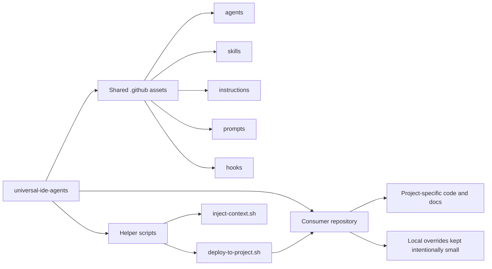

<!-- markdownlint-disable MD033 -->

# universal-ide-agents

<div align="center">

**A multi-IDE control room for reusable agents, skills, hooks, instructions, prompts, and helper scripts (supporting VS Code, Claude Code, and Antigravity).**

[](./CHANGELOG.md) [](https://code.visualstudio.com/) [](./CLAUDE.md) [](./docs/antigravity-consumption.md) [](./LICENSE) [](./docs/vscode-consumption.md)

## Social Media

[](https://www.youtube.com/@jsebastianbustos) [](https://github.com/Sebastian93BC) [](https://www.linkedin.com/in/sebastian-bustos-cordero-851a1421b/) [](https://x.com/bustos_cordero)

</div>

> [!IMPORTANT]
> `universal-ide-agents` supports **VS Code** (via Copilot Pro custom assets), **Claude Code** (via `CLAUDE.md` and global rules), and **Antigravity** (via native instructions and planning mode integrations).

<table>
  <tr>
    <td width="33%" valign="top">
      <strong>Why This Exists</strong><br /><br />
      You should not rebuild agent behavior, documentation rules, hook wiring, and reusable prompts from scratch in every repository.
    </td>
    <td width="33%" valign="top">
      <strong>What This Ships</strong><br /><br />
      Reusable VS Code assets stored under <code>.github/</code> plus helper scripts that make those assets easy to install and maintain across projects.
    </td>
    <td width="33%" valign="top">
      <strong>How It Is Used</strong><br /><br />
      Add this repository as a secondary source, sync the shared assets into a target workspace, then keep project-specific behavior thin and local.
    </td>
  </tr>
</table>

## Release Notes at a Glance

| Stream | Status | What it means |
| --- | --- | --- |
| `main` | Stable | Publish-ready baseline for shared VS Code assets |
| `dev` | Active | Ongoing work for new agents, skills, docs, and scripts |
| `test` | Validation | Safe branch for trying new flows before they are promoted |

## The Model



## What Lives Here

| Asset type | Purpose | Current location |
| --- | --- | --- |
| Agents | Multi-step VS Code workflows for planning, implementation, review, and orchestration | `.github/agents/` |
| Skills | Task-specific guidance bundles that improve discovery and reuse | `.github/skills/` |
| Instructions | Always-on or file-scoped rules for consistent outputs in VS Code & Antigravity | `.github/instructions/`, `.github/antigravity-instructions.md`, `.antigravity-instructions.md` |
| Prompts | Focused prompts for repeatable tasks | `.github/prompts/` |
| Hooks | Deterministic lifecycle automation for VS Code agents | `.github/hooks/` |
| Scripts | Portable shell helpers for setup, sync, and context injection | `scripts/` |
| Documentation | Catalog, consumption guides, roadmap, and release notes | `docs/`, `README.md`, `CHANGELOG.md` |

## Quick Start

To use these shared agents and assets in your project, follow this sequential step-by-step guide from the root directory of your **target repository**:

### 1. First-Time Setup (Instalación Inicial)

Execute the following commands in order:

1. **Add the submodule**: 
   Link this repository as a Git submodule inside the `.githubconfig/` directory:
   ```bash
   git submodule add git@github.com:Sebastian93BC/universal-ide-agents.git .githubconfig/universal-ide-agents
   ```

2. **Deploy the assets**:
   Run the deployment script from the submodule. Passing `"$PWD"` specifies your current working directory as the target to copy and map all configuration files:
   ```bash
   ./.githubconfig/universal-ide-agents/scripts/deploy-to-project.sh "$PWD"
   ```

### 2. Preview and Validation (Opcional)

If you want to see what files would be modified or created without actually applying the changes:
```bash
./.githubconfig/universal-ide-agents/scripts/deploy-to-project.sh --dry-run "$PWD"
```

### 3. Ongoing Updates (Cómo actualizar)

To pull new updates from the shared repository, update the submodule and trigger the redeployment. The `--clean` flag removes any obsolete shared assets that were deleted in the source repository since your last sync:
```bash
# 1. Update the submodule to the latest commit on main
git submodule update --remote --merge

# 2. Redeploy and clean up removed files
./.githubconfig/universal-ide-agents/scripts/deploy-to-project.sh --clean "$PWD"
```

### Despliegue y scaffolding de la carpeta `plans/`

El script de despliegue (`deploy-to-project.sh`) se encarga de estructurar automáticamente el directorio `plans/` en tu proyecto de destino.

- **Si el proyecto de destino NO tiene una carpeta `plans/`**:
  - Creará la carpeta `plans/` y las subcarpetas requeridas: `plans/knowledge/`, `plans/walkthroughs/` y `plans/historyPlans/`.
  - Copiará el estándar `plans/README.md`.
  - Inicializará un archivo de control de tareas vacío: `plans/registry.md`.

- **Si el proyecto de destino YA cuenta con una carpeta `plans/`**:
  - Realizará una **integración segura** y no destructiva.
  - Creará las subcarpetas que falten sin alterar tus planes locales.
  - Actualizará el archivo `plans/README.md`.
  - **No sobrescribirá** tu archivo de control `plans/registry.md` si ya existe, para prevenir la pérdida de tu historial local de tareas y estados.


## Editorial View

### Latest Entry

#### May 27, 2026 — v0.1.2-dev

This release delivers the deploy system and the agent evolution:

- `scripts/deploy-to-project.sh` is now the canonical deploy tool: maps `docs/` → `.github/docs/` and `scripts/` → `.github/scripts/`, rewrites the hook path in `context.json` for correct consumer resolution, supports `--dry-run` and `--clean`, and is idempotent
- `scripts/install-vscode-assets.sh` is deprecated in favor of the deploy script
- `Planner` now runs an `Explore` subagent for codebase research, follows a four-phase workflow, persists plans to sessions, and hands off to `Implementer`
- `Implementer` reads approved plans from session memory, logs progress to session folders, and has expanded tool access
- `Feature Builder` gained session tracking (slug generation, index logging) and integrates `Documentation Steward` before review
- Session infrastructure (`.github/sessions/`) provides historical context across delivery cycles
- `Documentation Steward` keeps README, changelog, and license-sensitive documentation aligned after each change

#### March 27, 2026

The repository launches as a clean VS Code asset hub with:

- Rewritten repository instructions aligned to the actual project goal
- A normalized agent layer for planning, architecture review, implementation, and code review
- A helper script for installing shared assets into target repositories
- A helper script for session context injection via hooks
- A documentation baseline with release notes, catalog, and roadmap

## Repository Layout

```text
.
├── .github/
│   ├── agents/
│   ├── hooks/
│   ├── instructions/
│   ├── prompts/
│   ├── sessions/
│   │   └── trace-db.jsonl
│   ├── skills/
│   └── copilot-instructions.md
├── docs/
│   ├── asset-catalog.md
│   ├── roadmap.md
│   └── vscode-consumption.md
├── plans/
│   ├── README.md
│   ├── registry.md
│   ├── historyPlans/
│   ├── knowledge/
│   │   └── knowledge_base.md
│   └── walkthroughs/
├── scripts/
│   ├── clean-notebook-outputs.py
│   ├── deploy-to-project.sh
│   ├── inject-context.sh
│   ├── install-vscode-assets.sh
│   ├── save-session-output.sh
│   └── scaffold-experimental-module.sh
├── CHANGELOG.md
├── CLAUDE.md
├── LICENSE
└── README.md
```

## Read the System

- [Asset catalog](./docs/asset-catalog.md)
- [VS Code consumption guide](./docs/vscode-consumption.md)
- [Antigravity consumption guide](./docs/antigravity-consumption.md)
- [Roadmap](./docs/roadmap.md)
- [Changelog](./CHANGELOG.md)

The shared agent layer currently covers:

- `Planner` for codebase research, structured plan design, session persistence, and self-validation
- `Documentation Steward` for source-control-aware updates to `README.md`, `CHANGELOG.md`, and conditional `LICENSE` maintenance
- `Reviewer` for final quality, safety, and maintainability review
- `Feature Builder` for orchestration across planning, native plan validation/implementation, documentation sync, review, and session tracking

## Versioning

This repository follows Semantic Versioning.

- `main` tracks the latest stable shared asset set.
- `dev` collects ongoing work.
- `test` exists for controlled validation before promotion.
- Tags should follow `vMAJOR.MINOR.PATCH`.

## Current Boundaries

This repository currently supports:

- VS Code custom agents
- Claude Code custom workflows & rules via `CLAUDE.md`
- VS Code prompts and instructions
- Antigravity native instructions & planning mode integration
- VS Code hook configuration
- Reusable shell helpers for installing and supporting those assets

This repository does not yet claim support for:

- JetBrains IDEs
- Zed
- Cursor
- Windsurf
- Generic cross-editor packaging

## Contribution Direction

If you extend this repository, optimize for one of these outcomes:

- Better reuse across multiple VS Code projects
- Safer automation and installation flows
- Stronger discoverability of the asset catalog
- Cleaner documentation and release discipline

## Footer

### Questions or improvements

- Use GitHub Issues for bugs, gaps, and enhancement requests.
- Use pull requests for new reusable assets or documentation refinements.
- Keep project-specific logic out of shared assets unless it is a documented extension point.

<div align="center">

**Build the workflow once. Reuse it everywhere.**

[](https://www.linkedin.com/in/sebastian-bustos-cordero-851a1421b/)

</div>
