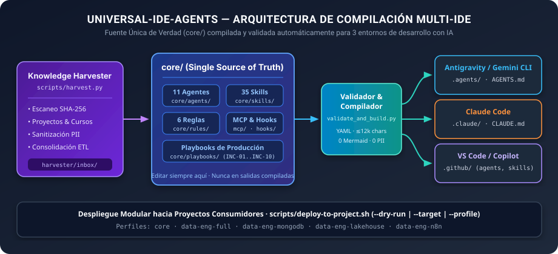

<div align="center">

# `universal-ide-agents`

### Multi-IDE Data Engineering Agent & Skill Hub

Repositorio centralizado y **Fuente Única de Verdad** de **Agentes, Subagentes, Skills (`SKILL.md`), Reglas, Hooks, Configuraciones MCP y Playbooks de Producción**, diseñado para **Ingeniería de Datos (Big Data y Datos Transaccionales de Alto Volumen)**.

<p>
  
  
  
</p>

<p>
  
  
  
  
  
</p>

<p>
  
  
  
  
  
  
  
  
</p>

<p>
  <a href="#1-arquitectura-y-compilación-multi-ide">Arquitectura</a> •
  <a href="#2-stack-principal-y-capacidades">Stack y Capacidades</a> •
  <a href="#3-flujo-de-uso-rápido">Flujo Rápido</a> •
  <a href="#4-perfiles-de-despliegue">Perfiles</a> •
  <a href="#5-documentación-clave">Documentación</a>
</p>

</div>

---

> [!IMPORTANT]
> **Fuente Única de Verdad (`core/`)**: Edita siempre los activos dentro de `core/` (`agents/`, `skills/`, `rules/`, `mcp/`, `hooks/`, `playbooks/`). Nunca modifiques manualmente las carpetas compiladas (`.agents/`, `.claude/`, `.github/`); regenera todo con `python3 scripts/validate_and_build.py`.

---

## 1. Arquitectura y Compilación Multi-IDE



<details>
<summary><strong>Ver estructura completa del repositorio</strong></summary>

```text
universal-ide-agents/
├── core/                              # FUENTE ÚNICA DE VERDAD (editar siempre aquí)
│   ├── agents/                        # 11 agentes canónicos (Data Engineering + Core Lifecycle)
│   ├── skills/                        # 36 skills modulares (categoría hub: solo este repositorio)
│   ├── rules/                         # 7 reglas, entre ellas los límites en tres niveles
│   ├── mcp/                           # Catálogo y plantillas MCP (dbt, dagster, duckdb, mongodb, postgres)
│   ├── hooks/                         # Guardián PreToolUse que aplica los límites
│   └── playbooks/                     # Playbook de incidentes reales de producción (INC-01..INC-10)
├── profiles/                          # Perfiles con extends: data-eng-base + herramienta (n8n, dagster-duckdb)
├── harvester/                         # Motor periódico Knowledge & Skill Harvester (ETL de memoria procedural)
├── scripts/
│   ├── validate_and_build.py          # Valida core/ y compila a los 3 IDE
│   ├── deploy.py · deploy-to-project.sh  # Despliegue por perfil; solo .agents/, .claude/, .github/
│   ├── check.py                       # Verificador único (make check; --project tras desplegar)
│   ├── scan_sensitive.py              # Escáner de datos sensibles
│   └── harvest.py                     # Escáner incremental SHA-256 de proyectos, cursos y memorias locales
├── .agents/                           # Salida compilada para Antigravity / Gemini CLI
├── .claude/                           # Salida compilada para Claude Code
├── .github/                           # Salida compilada para VS Code / GitHub Copilot
├── docs/                              # Catálogo de activos, guía multi-IDE y diagramas SVG (docs/img/)
├── plans/                             # Control Room de planes, registro de tareas y base de conocimiento
├── AGENTS.md                          # Única fuente de instrucciones
└── CLAUDE.md · GEMINI.md              # Punteros de una línea (@AGENTS.md)
```

</details>

---

## 2. Stack Principal y Capacidades

| Dominio | Tecnologías Cubiertas | Capacidades y Patrones Destacados |
| :--- | :--- | :--- |
| **Motores Transaccionales y Documentales** | `MongoDB` *(Replica Sets & Sharded Clusters)*, `PostgreSQL` | Pre-cálculo diario de ventanas móviles (`7d..180d`) con 1 lectura/día del crudo, histogramas para `P95` con `$setWindowFields`, mapa `lastSeen` para distincts, `$merge` seguro sin pérdida por *shallow merge*, `PROJECTION_COVERED` + `SHARDING_FILTER`, pre-split en 2 fases sobre colección vacía y gobernanza criptográfica **CSFLE / `crypt_shared`** (`_PLAIN`, `_HASH`, `_ENCRYPTED`). |
| **Lakehouse Columnar & Distribuido** | `DuckDB / DuckLake`, `Parquet`, `PySpark`, `Delta Lake`, `Apache Iceberg` | Offload analítico CDC `MongoDB -> Parquet -> DuckDB` con deduplicación vectorizada `QUALIFY ROW_NUMBER()`, salto de bloques por *Min-Max Zone Maps* (`ORDER BY` físico vs hiper-particionamiento), regla *Single-Writer* de DuckDB, *Liquid Clustering*, *Adaptive Query Execution (AQE)*, *Deletion Vectors* y *Change Data Feed (CDF)*. |
| **Orquestación, Transformación y Streaming** | `Dagster`, `Apache Airflow`, `dbt (1.9+)`, `Kafka + Debezium CDC`, `n8n` | Integración `Dagster + DuckDB + dbt` con `concurrency_key` y particiones sincronizadas, `dbt microbatch` con `lookback` para eventos tardíos, `contract: {enforced: true}`, `unit_tests:` nativos, equivalencia `Dagster <-> Airflow (Cosmos)`, *Outbox Pattern* + Schema Registry `BACKWARD_TRANSITIVE` y flujos n8n *Hub-and-Spoke* sin estado. |
| **Calidad, Linaje, Observabilidad e IA** | `5 Medallion Safety Guards`, `Great Expectations`, `OpenLineage`, `OpenTelemetry (OTel)` | Compuertas *Freshness/Lag*, *Writer `.tmp`*, *Lineage Consistency*, *Row Regression (`0.98`)* y *Dry-Run Judge*; trazas OTel en 3 niveles (`Módulo -> Proceso -> Operación`); y triaje inteligente de incidentes con `pipeline-incident-triage` sobre servidores **MCP** en modo `--read-only`. |

---

## 3. Flujo de Uso Rápido

### A. Validar y Compilar Activos tras Editar `core/`

```bash
python3 scripts/validate_and_build.py   # compila
make check                              # verificador único + pruebas
```

### B. Ejecutar el Recopilador Periódico (*Knowledge Harvester*)

Escanea tus proyectos y cursos locales en busca de nuevas skills, reglas o hallazgos técnicos:

```bash
# 1. Inicializar configuración local de rutas (ignorado por Git)
python3 scripts/harvest.py --init-local-config

# 2. Escaneo incremental SHA-256 (genera harvester/inbox/<YYYY-MM-DD>/harvest_report.md)
python3 scripts/harvest.py

# 3. Una vez generalizados y compilados los nuevos activos en core/, marcar como procesado
python3 scripts/harvest.py --mark-processed
```

### C. Desplegar hacia un Proyecto Consumidor

> [!TIP]
> El despliegue escribe solo bajo `.agents/`, `.claude/` y `.github/`, nunca toca `AGENTS.md`, `CLAUDE.md` ni `GEMINI.md`, y deja el manifiesto `.agents/universal-ide-agents.json`. Ejecuta primero con `--dry-run`.

```bash
# Desde el proyecto, con el submódulo por HTTPS en .modules/universal-ide-agents
.modules/universal-ide-agents/scripts/deploy-to-project.sh --dry-run --profile data-eng-n8n .
.modules/universal-ide-agents/scripts/deploy-to-project.sh --profile data-eng-n8n .
python3 .modules/universal-ide-agents/scripts/check.py --project .
```

---

## 4. Perfiles de Despliegue

Un perfil base agnóstico de la herramienta de ETL y la herramienta como añadido (`extends`). Se combinan con comas.

| Perfil | Extiende | Uso |
| :--- | :--- | :--- |
| `core` | — | Ciclo de vida, revisión, TDD, documentación, cierre de tarea, traspaso y límites. |
| `data-eng-base` | `core` | Núcleo, MongoDB y modelado de datos, sin herramienta de ETL. |
| `data-eng-n8n` | `data-eng-base` | Proyectos con módulos en n8n. |
| `data-eng-dagster-duckdb` | `data-eng-base` | Proyectos con módulos en Dagster sobre DuckDB y Parquet. |
| `data-eng-lakehouse` | `data-eng-dagster-duckdb` | Añade dbt, PySpark/Delta/Iceberg, Kafka/Debezium y Airflow. |
| `data-eng-full` | `data-eng-n8n`, `data-eng-lakehouse` | Todo lo desplegable; para explorar. |

---

## 5. Documentación Clave

| Documento | Descripción |
| :--- | :--- |
| **[Catálogo Completo de Activos](./docs/asset-catalog.md)** | Inventario detallado de los 11 agentes, 36 skills, 7 reglas, el hook y las plantillas MCP. |
| **[Guía de Consumo Multi-IDE](./docs/multi-ide-consumption.md)** | Qué se despliega, perfiles y qué carga cada IDE (comprobado). |
| **[Contrato con `template-data-flow-automation`](./docs/contrato-template-dfa.md)** | Inclusión, despliegue, manifiesto, verificador, guardián y cierre de tarea con `dfa`. |
| **[Playbook de Producción (`INC-01..INC-10`)](./core/playbooks/data-engineering-production-playbook.md)** | Resolución forense de incidentes reales en MongoDB, DuckDB, Dagster y dbt. |
| **[Catálogo de Servidores MCP](./core/mcp/catalog.md)** | Configuración segura (`--read-only`) de MCPs para ingeniería de datos. |
| **[Extracción Maestra de Conocimientos](./plans/knowledge/2026-11-18-project-courses-web-knowledge-extraction.md)** | Síntesis consolidada de proyectos, cursos e investigación técnica. |
