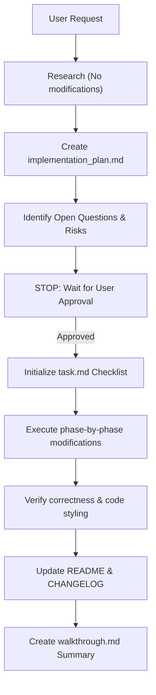

# Antigravity Consumption Guide

This guide explains how to consume the `universal-ide-agents` shared assets in projects using the **Antigravity** agentic AI coding environment.

---

## 1. Overview

Antigravity operates natively in pair-programming mode using standard workspace files. Unlike VS Code custom agents which rely on separate YAML frontmatter files, Antigravity acts as a unified agent that reads **always-on instructions** from `.antigravity-instructions.md` and coordinates workflows via standard planning artifacts.

Integrating `universal-ide-agents` provides:
- **Consistent instructions**: Shared coding conventions, visual quality bars, and directory structures.
- **Structured role-play**: Directives that instruct Antigravity to step into the shoes of a Planner, Implementer, Reviewer, or Documentation Steward.
- **Native Planning loops**: Deep alignment with Antigravity's native task-execution mechanics.

---

## 2. Path Mapping

The canonical deployment script `deploy-to-project.sh` copies all core Antigravity assets into the consumer repository:

| Source in `universal-ide-agents` | Destination in consumer project | Description |
| --- | --- | --- |
| `.github/antigravity-instructions.md` | `.github/antigravity-instructions.md` | Core instructions, coding styles, and role rules |
| `.antigravity-instructions.md` | `.antigravity-instructions.md` | Root duplicate to facilitate immediate auto-discovery |
| `docs/` | `.github/docs/` | Comprehensive shared asset catalogs and guides |
| `scripts/` | `.github/scripts/` | Helper scripts for context injection and deployment |

---

## 3. Submodule Integration

We recommend keeping `universal-ide-agents` as a Git submodule at `.githubconfig/universal-ide-agents/` and running the deploy script to sync assets.

### First-Time Setup
Add the submodule to the consumer project:
```bash
git submodule add git@github.com:Sebastian93BC/universal-ide-agents.git .githubconfig/universal-ide-agents
```

Deploy the shared assets:
```bash
./.githubconfig/universal-ide-agents/scripts/deploy-to-project.sh "$PWD"
```

### Ongoing Synchronization
Pull updates and redeploy, cleaning up obsolete files:
```bash
git submodule update --remote --merge
./.githubconfig/universal-ide-agents/scripts/deploy-to-project.sh --clean "$PWD"
```

---

## 4. Antigravity Planning Mode Integration

Antigravity's built-in **Planning Mode** perfectly replaces the split `Planner` and `Implementer` VS Code agents by using persistent workspace files.



### A. Planning Phase (Planner Role)
- Antigravity conducts thorough codebase research without modifying any files.
- It drafts the `implementation_plan.md` artifact, specifying:
  - High-level approach and user constraints.
  - Proposed changes broken down by component.
  - **Open Questions** to resolve any design ambiguity.
- It sets `RequestFeedback: true` in the metadata, presents the plan to the user, and **stops to wait for approval**.

### B. Implementation Phase (Implementer Role)
- Once approved, Antigravity creates a detailed checklist in the `task.md` artifact.
- It marks items as `[/]` (in progress) or `[x]` (completed) as it executes changes.
- It verifies each change using compilers, linting, and automated test runners.

### C. Wrap-up Phase (Documentation Steward & Reviewer Roles)
- Upon completion, Antigravity updates the project's documentation and logs.
- It compiles a thorough summary of changes, manual validation results, and visual recordings in the `walkthrough.md` artifact.

---

## 5. Interactive Commands

To maximize efficiency, direct the Antigravity agent using native slash commands when performing specific tasks:

- **/grill-me**: Initiates an interactive question-and-answer interview. Use this during the planning stage to align on design decisions and resolve architecture questions.
- **/goal**: Scopes long-running, multi-step operations (like migrations or full refactorings). Instructs the agent to remain extremely thorough and proceed continuously until the goal is fully achieved.
- **/schedule**: Schedules recurring validations or one-shot timers (e.g., polling build tasks).
